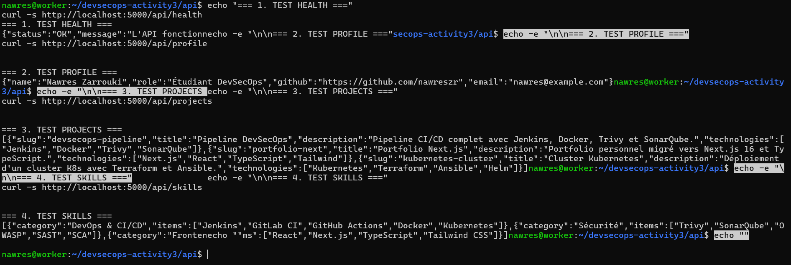
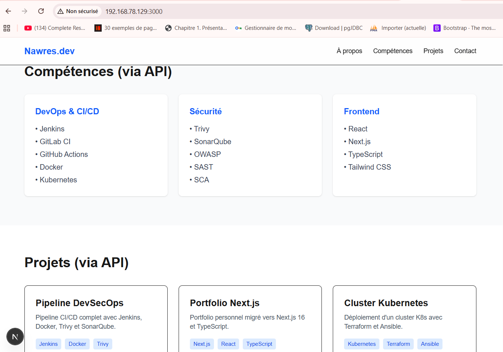
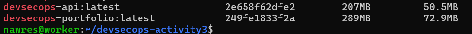
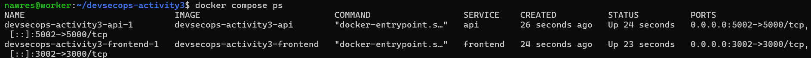
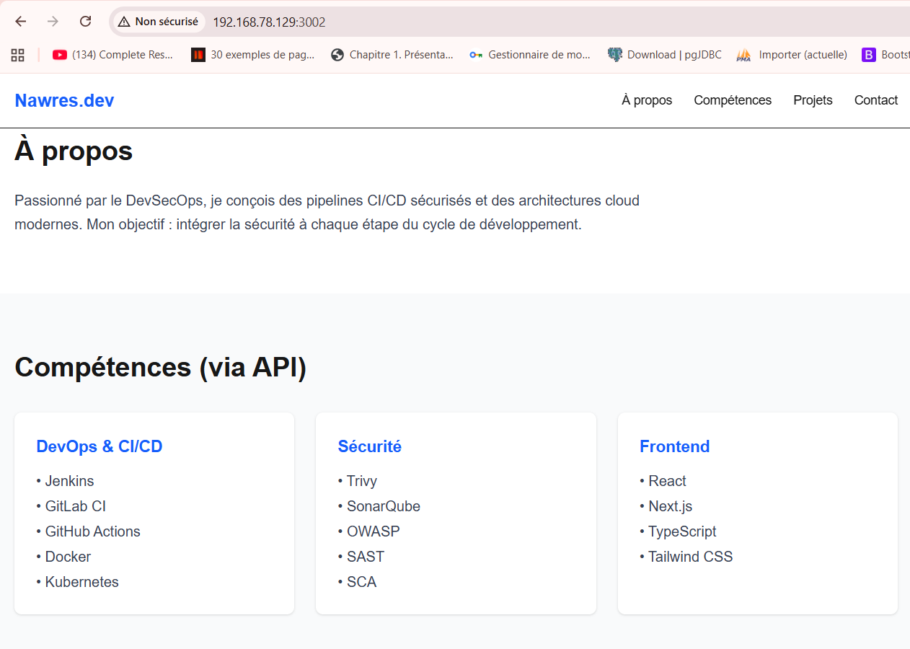

# Activité 3 – Ansible, API Node.js/Express et Docker Compose

> **Enseignant :** Wahid Hamdi
> **Auteur :** Nawres Zarrouki
> **Thèmes :** automatisation avec Ansible, API Express, variables d'environnement, dockerisation frontend + API

## Sommaire

- [VII. Automatisation avec Ansible](#vii-automatisation-avec-ansible)
- [VIII. API Node.js / Express](#viii-api-nodejs--express)
- [IX. Variables d'environnement et configuration](#ix-variables-denvironnement-et-configuration)
- [X. Dockerisation frontend + API](#x-dockerisation-frontend--api)

Les captures d'écran sont dans le dossier [`docs/`](docs/).

---

## VII. Automatisation avec Ansible

### 25. Installation d'Ansible

```bash
sudo apt update
sudo apt install -y ansible
ansible --version
```

### 26. Inventory et test de communication

Fichier `inventory` :

```ini
[servers]
localhost ansible_connection=local
# Pour un serveur distant :
# 192.168.42.130 ansible_user=nawres
```

Commande de test :

```bash
ansible all -i inventory -m ping
```


### 27. Premier playbook : installer un package (curl)

Fichier `install_curl.yml` :

```yaml
---
- name: Installer curl
  hosts: all
  become: true
  tasks:
    - name: Installer le package curl
      ansible.builtin.apt:
        name: curl
        state: present
        update_cache: true
```

```bash
ansible-playbook -i inventory install_curl.yml
```


### 28. Playbook d'installation de Docker

Fichier `install_docker.yml` :

```yaml
---
- name: Installer Docker proprement
  hosts: all
  become: true
  tasks:
    - name: Supprimer les paquets Docker conflictuels (dépôt officiel)
      ansible.builtin.apt:
        name:
          - docker.io
          - docker-compose
          - docker-doc
          - podman-docker
        state: absent

    - name: Mettre à jour le cache apt
      ansible.builtin.apt:
        update_cache: true

    - name: Installer Docker et Docker Compose (dépôts Ubuntu)
      ansible.builtin.apt:
        name:
          - docker.io
          - docker-compose-v2
        state: present

    - name: Démarrer et activer le service Docker
      ansible.builtin.service:
        name: docker
        state: started
        enabled: true

    - name: Ajouter l'utilisateur au groupe docker
      ansible.builtin.user:
        name: "{{ ansible_user_id }}"
        groups: docker
        append: true
```

```bash
ansible-playbook -i inventory install_docker.yml
docker --version
```

Résultat : `PLAY RECAP : ok=6 changed=4 unreachable=0 failed=0` et `Docker version 29.1.3`.


---

## VIII. API Node.js / Express

### 29. Structure du projet et démarrage

```
api/
├── package.json
├── server.js
└── data/
    ├── profile.json
    ├── projects.json
    └── skills.json
.env.example
.gitignore
```

```bash
cd api
npm init -y
npm install express cors dotenv
node server.js
```

Fichier `api/server.js` :

```js
require("dotenv").config();
const express = require("express");
const cors = require("cors");

const profile = require("./data/profile.json");
const projects = require("./data/projects.json");
const skills = require("./data/skills.json");

const app = express();
app.use(cors());

app.get("/api/health", (req, res) => {
  res.json({ status: "ok", message: "API opérationnelle" });
});

app.get("/api/profile", (req, res) => res.json(profile));
app.get("/api/projects", (req, res) => res.json(projects));
app.get("/api/skills", (req, res) => res.json(skills));

const PORT = process.env.PORT || 5000;
app.listen(PORT, () => console.log(`API démarrée sur le port ${PORT}`));
```

### 30. Route `GET /api/health`

Retourne l'état de l'API.

```bash
curl http://localhost:5000/api/health
```

### 31. Route `GET /api/profile`

Retourne les informations principales du Portfolio au format JSON.

```bash
curl http://localhost:5000/api/profile
```

### 32. Route `GET /api/projects`

Retourne la liste des projets du Portfolio.

```bash
curl http://localhost:5000/api/projects
```

### 33. Route `GET /api/skills`

Retourne la liste des compétences.

```bash
curl http://localhost:5000/api/skills
```

### Résultat des tests (questions 30 à 33)

La capture suivante regroupe les quatre appels `curl` : `/api/health`, `/api/profile`, `/api/projects` et `/api/skills`.



### 34. Frontend Next.js : projets depuis l'API

Le frontend ne lit plus uniquement des données locales : il appelle l'API Express avec `fetch` et affiche la réponse JSON.

```js
const res = await fetch(`${process.env.NEXT_PUBLIC_API_URL}/api/projects`, { cache: "no-store" });
const projects = await res.json();
```

### 35. Frontend Next.js : compétences depuis l'API

Même principe pour les compétences, avec `/api/skills`.

```js
const res = await fetch(`${process.env.NEXT_PUBLIC_API_URL}/api/skills`, { cache: "no-store" });
const skills = await res.json();
```

### Résultat (questions 34 et 35)

Le frontend consomme l'API : les projets et les compétences affichés viennent des routes `/api/projects` et `/api/skills`.



---

## IX. Variables d'environnement et configuration

### 36. Variable `API_URL`

L'URL de l'API est configurée via la variable d'environnement `API_URL`.

**Pourquoi ne pas la coder en dur ?**

- L'URL change selon l'environnement : `localhost` en développement, `api` dans Docker Compose, un domaine en production.
- Changer d'environnement ne demande alors aucune modification du code ni de reconstruction.
- La configuration reste séparée du code, ce qui est une bonne pratique de sécurité et de déploiement.

### 37. Fichier `.env.example`

Fichier d'exemple, **sans aucun secret réel**. Le vrai `.env` est ignoré par Git.

Commandes utilisées pour le créer :

```bash
# 1. Créer le fichier .env.example (qui ira sur GitHub)
cat > .env.example << 'EOT'
# Fichier d'exemple de variables d'environnement
# Ne jamais mettre de vrais secrets ici !

# Port d'écoute de l'API Express
PORT=5000

# URL de l'API (utilisée par le Frontend Next.js)
API_URL=http://localhost:5000
EOT

# 2. Créer le vrai fichier .env local (qui reste sur la VM)
cp .env.example .env

# 3. Ajouter .env au .gitignore pour éviter de le pousser sur GitHub par erreur
echo ".env" >> .gitignore
echo "node_modules/" >> .gitignore
echo "api/node_modules/" >> .gitignore
```

Contenu de `.env.example` :

```env
# Fichier d'exemple de variables d'environnement
# Ne jamais mettre de vrais secrets ici !

# Port d'écoute de l'API Express
PORT=5000

# URL de l'API (utilisée par le Frontend Next.js)
API_URL=http://localhost:5000
```

Contenu ajouté à `.gitignore` :

```gitignore
.env
node_modules/
api/node_modules/
```

---

## X. Dockerisation frontend + API

### 38. Dockerfile du frontend Next.js

Fichier `Dockerfile.frontend` :

```dockerfile
# --- Étape 1 : Build ---
FROM node:20-alpine AS builder
WORKDIR /app
COPY frontend/package*.json ./
RUN npm config set registry https://registry.npmmirror.com && npm install
COPY frontend/ .
ARG NEXT_PUBLIC_API_URL=http://api:5000
ENV NEXT_PUBLIC_API_URL=$NEXT_PUBLIC_API_URL
RUN npm run build

# --- Étape 2 : Runner ---
FROM node:20-alpine AS runner
WORKDIR /app
ENV NODE_ENV=production
ENV PORT=3000
ENV HOSTNAME="0.0.0.0"
COPY --from=builder /app/public ./public
COPY --from=builder /app/.next/standalone ./
COPY --from=builder /app/.next/static ./.next/static
EXPOSE 3000
CMD ["node", "server.js"]
```

Ce Dockerfile installe les dépendances, construit l'application Next.js puis la démarre dans un conteneur.

### 39. Dockerfile de l'API Node.js / Express

Fichier `Dockerfile.api` :

```dockerfile
FROM node:20-alpine
WORKDIR /app
COPY api/package*.json ./
RUN npm config set registry https://registry.npmmirror.com && npm install
COPY api/ .
EXPOSE 5000
CMD ["node", "server.js"]
```

Ce Dockerfile installe les dépendances de l'API, copie le code et lance le serveur Express.

### 40. Construction des images Docker

```bash
docker build -t devsecops-portfolio -f Dockerfile.frontend .
docker build -t devsecops-api -f Dockerfile.api .
docker images | grep devsecops
```



### 41. Docker Compose

Fichier `docker-compose.yml` :

```yaml
services:
  api:
    build:
      context: .
      dockerfile: Dockerfile.api
    ports:
      - "5002:5000"

  frontend:
    build:
      context: .
      dockerfile: Dockerfile.frontend
      args:
        NEXT_PUBLIC_API_URL: http://192.168.78.129:5002
    ports:
      - "3002:3000"
    depends_on:
      - api
```

```bash
docker compose up -d --build
docker compose ps
```



### 42. Communication frontend ↔ API dans le réseau Docker Compose

Docker Compose place les deux services dans un même réseau, où ils se joignent par leur nom (par exemple http://api:5000 de conteneur à conteneur). Ici, le navigateur appelle directement l API. Le frontend reçoit donc au build la variable NEXT_PUBLIC_API_URL=http://192.168.78.129:5002, c est-à-dire l adresse de la VM et le port publié 5002 qui redirige vers le port 5000 de l API.


**Application finale**



