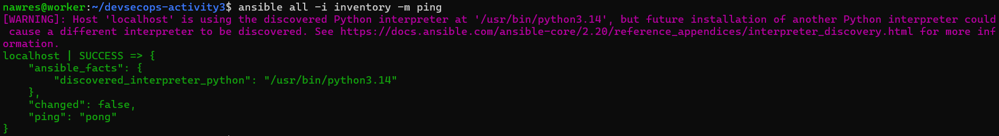
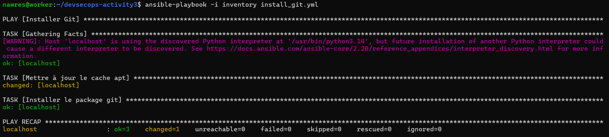
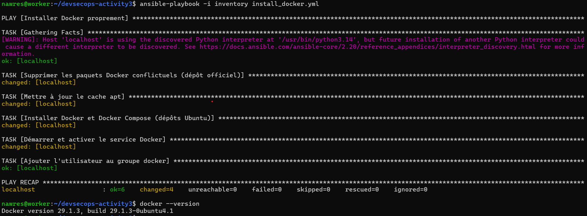

# Activité 3 – Ansible, API Node.js/Express et Docker Compose

> **Enseignant :** Wahid Hamdi
> **Auteur :** Nawres Zarrouki
> **Thèmes :** automatisation avec Ansible, API Express, variables d'environnement, dockerisation frontend + API

## Sommaire

- [VII. Automatisation avec Ansible](#vii-automatisation-avec-ansible)
- [VIII. API Node.js / Express](#viii-api-nodejs--express)
- [IX. Variables d'environnement](#ix-variables-denvironnement)
- [X. Dockerisation frontend + API](#x-dockerisation-frontend--api)

Les captures d'écran sont dans le dossier [`docs/`](docs/).

---

## VII. Automatisation avec Ansible

### 25. Installation d'Ansible

```bash
sudo apt update
sudo apt install -y ansible
ansible --version
```

### 26. Inventory et test de communication

Fichier `inventory` :

```ini
[servers]
localhost ansible_connection=local
# Pour un serveur distant :
# 192.168.42.130 ansible_user=nawres
```

Commande de test :

```bash
ansible all -i inventory -m ping
```



### 27. Premier playbook : installer un package (curl)

Fichier `install_curl.yml` :

```yaml
---
- name: Installer curl
  hosts: all
  become: true
  tasks:
    - name: Installer le package curl
      ansible.builtin.apt:
        name: curl
        state: present
        update_cache: true
```

```bash
ansible-playbook -i inventory install_curl.yml
```



### 28. Playbook d'installation de Docker

Fichier `install_docker.yml` :

```yaml
---
- name: Installer Docker proprement
  hosts: all
  become: true
  tasks:
    - name: Supprimer les paquets Docker conflictuels (dépôt officiel)
      ansible.builtin.apt:
        name:
          - docker.io
          - docker-compose
          - docker-doc
          - podman-docker
        state: absent

    - name: Mettre à jour le cache apt
      ansible.builtin.apt:
        update_cache: true

    - name: Installer Docker et Docker Compose (dépôts Ubuntu)
      ansible.builtin.apt:
        name:
          - docker.io
          - docker-compose-v2
        state: present

    - name: Démarrer et activer le service Docker
      ansible.builtin.service:
        name: docker
        state: started
        enabled: true

    - name: Ajouter l'utilisateur au groupe docker
      ansible.builtin.user:
        name: "{{ ansible_user_id }}"
        groups: docker
        append: true
```

```bash
ansible-playbook -i inventory install_docker.yml
docker --version
```

Résultat : `PLAY RECAP : ok=6 changed=4 unreachable=0 failed=0` et `Docker version 29.1.3`.



---

## VIII. API Node.js / Express

_À compléter._

## IX. Variables d'environnement

_À compléter._

## X. Dockerisation frontend + API

_À compléter._
